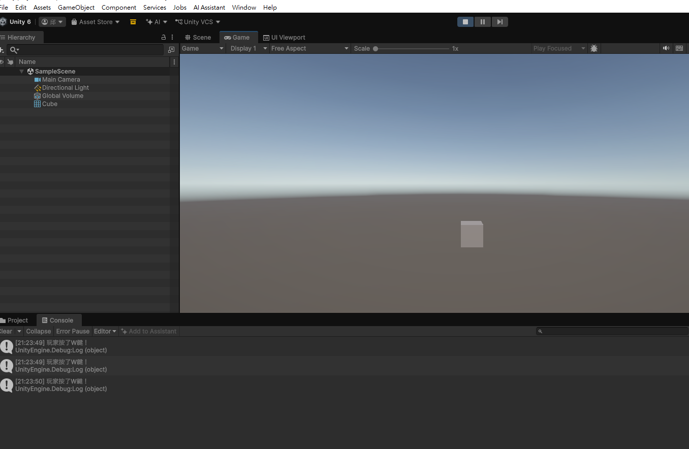
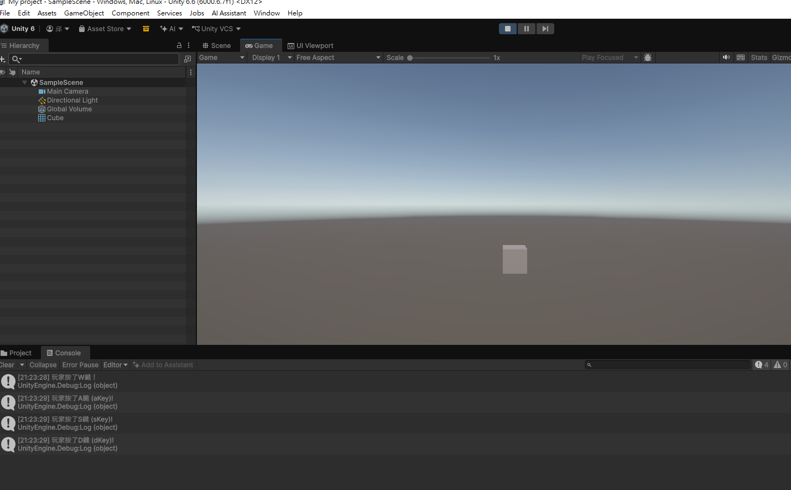

# 第2次練習題目-隨堂-QZ2
>
>學號：113111136
><br />
>姓名：邱致鑫
><br />
>作業撰寫時間：100 mins
><br />
>最後撰寫文件日期：2026/10/29 
>

本份文件包含以下主題：(至少需下面兩項，若是有多者可以自行新增)
- [x] 說明內容
- [x] 其他 (可以包含心得或是想跟老師反映)

## 說明內容

開始寫說明，該說明需說明想法，
並於之後再對上述想法的每一部分將程式進一步進行展現，
若需引用程式區則使用下面方法，
若為.cs檔內程式除了於敘述中需註明檔案名稱外，
還需使用語法` ```語言種類 程式碼 ``` `，其中語言種類若是要用python則使用py，java則使用java，C/C++則使用cpp，
下段程式碼為語言種類選擇csharp使用後結果：

```csharp
public void mt_getResult(){
    ...
}
```

若要於內文中標示部分網頁檔，則使用以下標籤` ```html 程式碼 ``` `，
下段程式碼則為使用後結果：

```html
<%@ Page Language="C#" AutoEventWireup="true" ...>

<!DOCTYPE html>

<html xmlns="http://www.w3.org/1999/xhtml">
<head runat="server">
<meta http-equiv="Content-Type" ...>
    <title></title>
</head>
<body>
    <form id="form1" runat="server">
        <div>
        </div>
    </form>
</body>
</html>
```
更多markdown方法可參閱[https://ithelp.ithome.com.tw/articles/10203758](https://ithelp.ithome.com.tw/articles/10203758)

請在撰寫"說明程式與內容"該塊內容，請把原該塊內上述敘述刪除，該塊上述內容只是用來指引該怎麼撰寫內容。

1. (需截圖說明，並且需截圖執行結果)

Ans:
public class PlayerController : MonoBehaviour // 宣告一個公開的 PlayerController 類別，並繼承 MonoBehaviour（讓腳本能掛載到物件上）
{ // PlayerController 類別的區塊開始
    
    // Update is called once per frame
    void Update() // 宣告 Update 方法，此方法會在遊戲執行時的「每一個影格」被 Unity 自動呼叫一次
    { // Update 方法的區塊開始

        // 1. 偵測玩家是否按下 W 鍵
        if (Input.GetKeyDown(KeyCode.W)) // 條件判斷式：Input.GetKeyDown 用於偵測「按鍵被按下那一瞬間」的動作
        { // 條件成立的區塊開始
            Debug.Log("玩家按了W鍵！"); // 當按下 W 鍵時，在 Unity 下方主控制台（Console）印出指定訊息
        } // 條件區塊結束
    } // Update 方法的區塊結束

} // PlayerController 類別的區塊結束
2. (需截圖說明，並且需截圖執行結果)

Ans:
using UnityEngine; // 引入 Unity 核心程式庫，讓腳本可以使用 MonoBehaviour 等基礎功能

public class PlayerController : MonoBehaviour // 宣告一個公開的 PlayerController 類別，並繼承 MonoBehaviour（讓腳本能掛載到物件上）
{ // PlayerController 類別的區塊開始
    
    // Update is called once per frame
    void Update() // 宣告 Update 方法，此方法會在遊戲執行時的「每一個影格」被 Unity 自動呼叫一次
    { // Update 方法的區塊開始

        // 1. 偵測玩家是否按下 W 鍵
        if (Input.GetKeyDown(KeyCode.W)) // 條件判斷式：Input.GetKeyDown 用於偵測「按鍵被按下那一瞬間」的動作
        { // 條件成立的區塊開始
            Debug.Log("玩家按了W鍵！"); // 當按下 W 鍵時，在 Unity 下方主控制台（Console）印出指定訊息
        } // 條件區塊結束

        // 2. 偵測 A、S、D 鍵分別用 aKey、sKey、dKey 偵測
        if (Input.GetKeyDown(KeyCode.A)) // 條件判斷式：偵測 A 鍵是否被按下
        {
            Debug.Log("玩家按了A鍵 (aKey)!"); // 按下 A 鍵時印出訊息
        }

        if (Input.GetKeyDown(KeyCode.S)) // 條件判斷式：偵測 S 鍵是否被按下
        {
            Debug.Log("玩家按了S鍵 (sKey)!"); // 按下 S 鍵時印出訊息
        }

        if (Input.GetKeyDown(KeyCode.D)) // 條件判斷式：偵測 D 鍵是否被按下
        {
            Debug.Log("玩家按了D鍵 (dKey)!"); // 按下 D 鍵時印出訊息
        }

    } // Update 方法的區塊結束

} // PlayerController 類別的區塊結束
## 其他